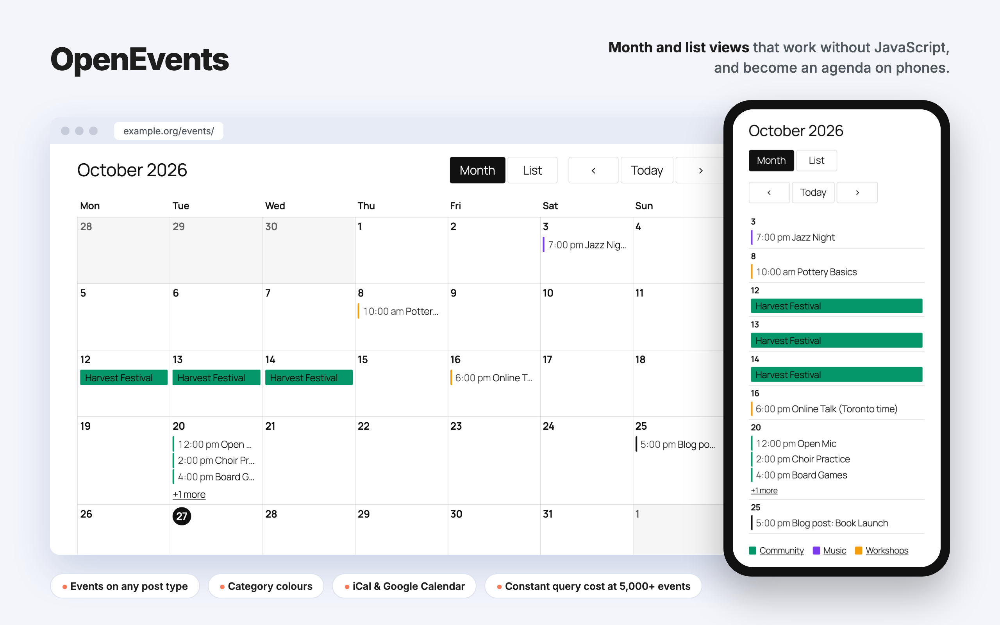
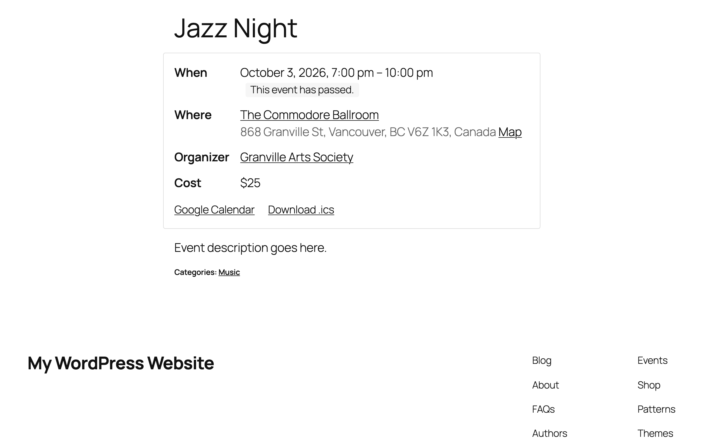
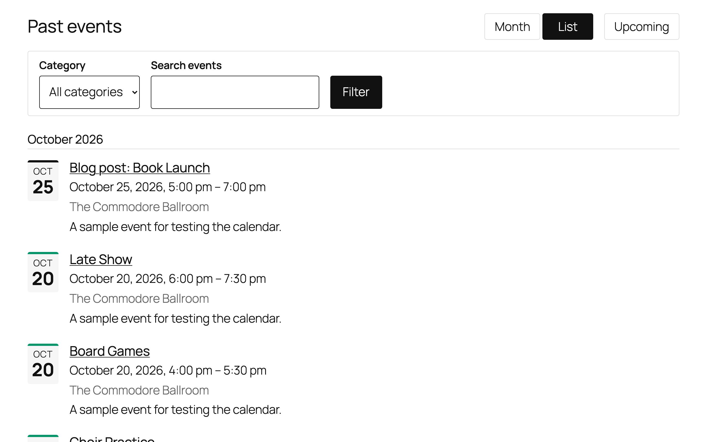
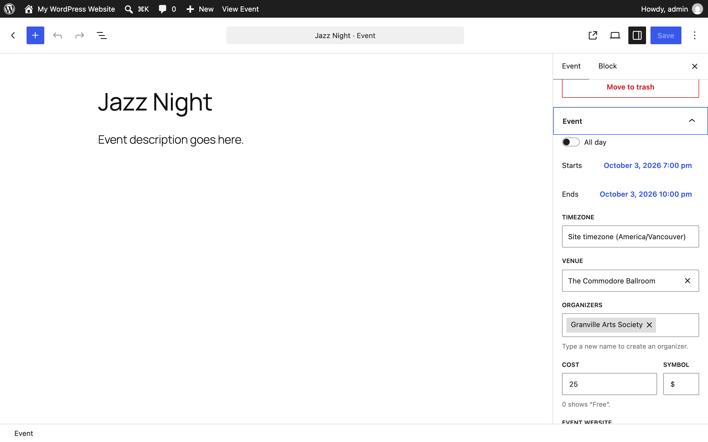
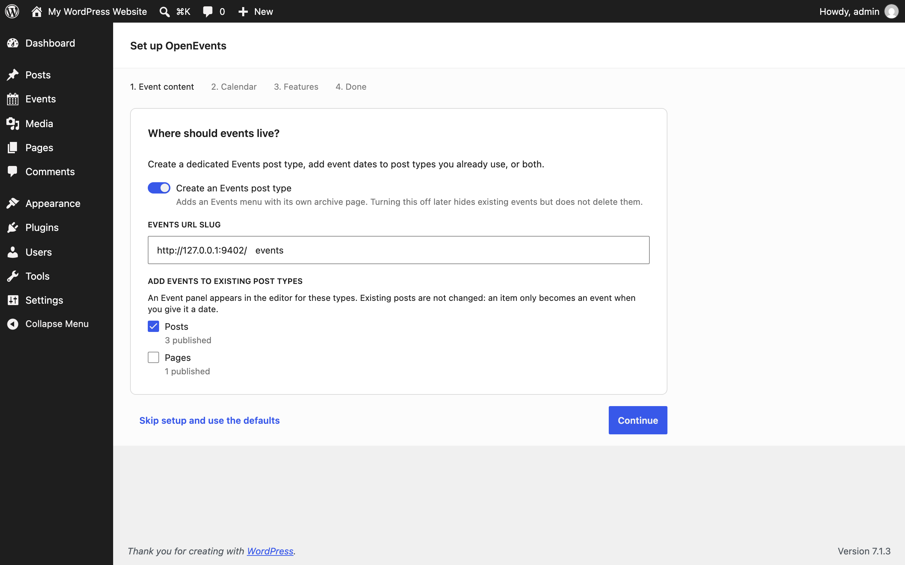
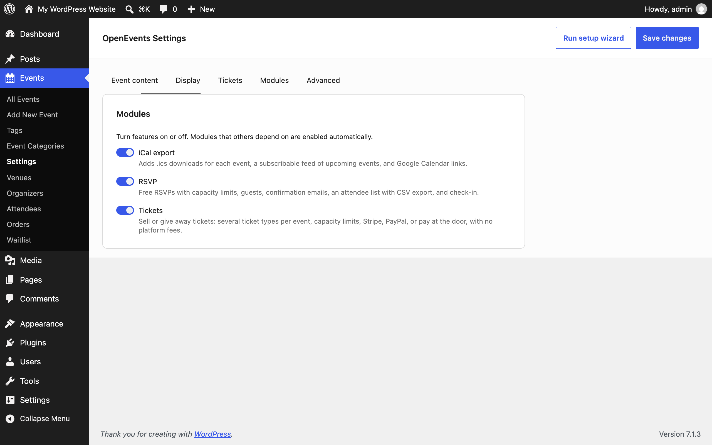
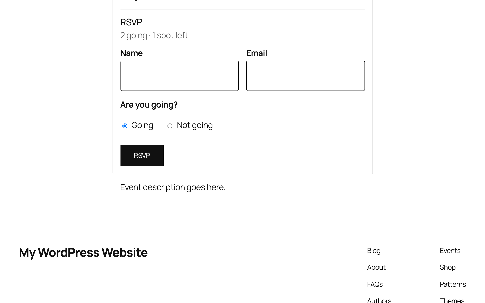
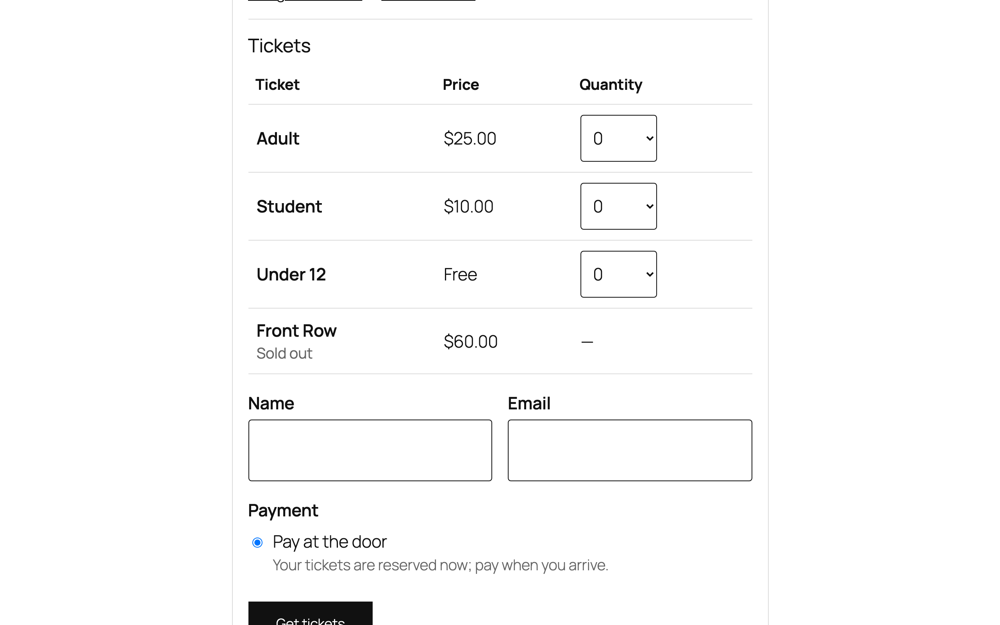
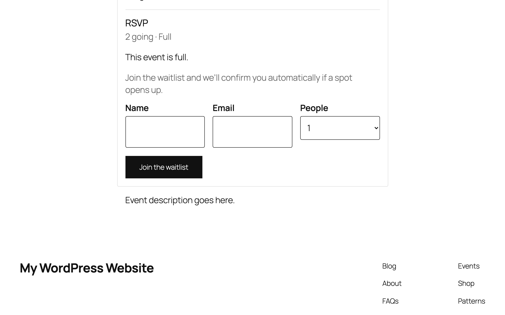

# OpenEvents

Open-source events for WordPress, built to replace The Events Calendar and its paid add-ons. **OpenEvents Calendar** is the core; **RSVP**, **Tickets**, recurrence, and more are modules you switch on, with no upsells.



**[Try it in WordPress Playground](https://playground.wordpress.net/?blueprint-url=https://raw.githubusercontent.com/bmx269/OpenEvents/main/.wordpress-org/blueprints/blueprint.json)** to test the plugin in your browser, with nothing to install. The demo loads sample events, venues, and coloured categories for the current month, and opens on the calendar. You're logged in as admin, so you can try the setup wizard (**Events → Settings → Run setup wizard**) and the editor too.

- **Requires:** WordPress 7.1+, PHP 8.2+
- **License:** GPLv2 or later
- **Status:** in development. The demo is rebuilt from `main` on every push.

- **Events on any post type.** Use a dedicated Events post type, add event dates to post types you already have, or both. Existing posts are never changed.
- **Fast at library scale.** Listings read one indexed table and batch-load everything they render. With 5,000 events, a month view costs 2 more queries than a plain page.
- **Works without JavaScript.** Calendar views are server-rendered links. The Interactivity API upgrades them to in-place navigation.
- **Theme-friendly.** Blocks inherit your theme.json, the templates are editable in the Site Editor, and classic themes get fallbacks.
- **Recurring events.** Daily, weekly, monthly, or yearly rules (standard iCal RRULE), skipped and extra dates, and editing one date or the rest of a series.
- **Free RSVP and tickets.** Capacity limits, guests, waitlists, attendee questions (with consent boxes), pay at the door, Stripe, or PayPal, with no platform fees. See [docs/payments.md](docs/payments.md).
- **Open APIs.** PHP functions, hooks, a module registry, REST, the Abilities API, Block Bindings, and editor SlotFills.

Requires WordPress 7.1+ and PHP 8.2+.

## Screenshots

| | |
| --- | --- |
|  |  |
| Event details: date, venue with map link, organizer, cost, and Add to Google Calendar / .ics | List view, grouped by month, with past and upcoming events |
|  |  |
| Event panel in the editor: dates, timezone, venue and organizers (type a name to create one), cost | Setup wizard: a dedicated Events post type, existing post types, or both |
|  |  |
| Settings, built on the WordPress Design System; modules switch features on and off | RSVP: places left, guests, and a "not going" option. Works without JavaScript and on cached pages |
|  |  |
| Tickets: several types per event with price, capacity, and sale window; pay at the door, Stripe, or PayPal | Waitlist: a full event takes names and confirms them automatically when a place frees up |

## Status

| Area | Status |
| --- | --- |
| **Phase 1: core foundation** (events on any post type, venues, organizers, category colours, month/list calendar, templates, REST, Abilities, iCal, WP-CLI) | ✅ Done |
| **RSVP**: capacity, guests, deadlines, private change/cancel links, attendee list with CSV export and check-in | ✅ Done |
| **Tickets**: several ticket types per event, pay at the door, Stripe, PayPal, refunds, order emails | ✅ Done |
| **Waitlists** for RSVPs (automatic promotion) and ticket types (time-limited offers), with an organiser screen | ✅ Done |
| **Recurring events**: daily to yearly rules (iCal RRULE), skipped and extra dates, edit one date or the rest of a series | ✅ Done |
| **Attendee fields**: questions per RSVP or ticket type (ten field types, consent boxes), each person's own name and email, saved question sets, answers in the attendee list and CSV | ✅ Done |
| **Series**: group events under a series page, with series passes | ✅ Done |
| **TEC and Event Tickets importer** (`wp openevents import-tec`): in-place conversion with verification and rollback | ✅ Done |
| **Privacy tools**: attendee data in WordPress's personal data export and erase | ✅ Done |
| **Week and day views** | ✅ Done |
| **Event attributes and calendar filters**: lists such as Audiences, filter by attribute and day of the week | ✅ Done |
| Per-date RSVP and tickets for recurring events | 🚧 In progress |
| Calendar filter and search, event popups, category badges, per-category and per-post-type templates | ✅ Done |
| Google Calendar import (iCal feeds) | Next |
| Ticket QR codes and door check-in, Pro views (week, photo, map) | Planned |

Details and the order of work are in [docs/ROADMAP.md](docs/ROADMAP.md).

## Development

```bash
npm install
npm run build          # or: npm start (watch)
npm run playground     # WordPress Playground with the plugin and sample events
npm run bench          # Playground with 5,000 generated events; add ?openevents_bench=1 to a page
npm run lint:js
```

### Tests

```bash
composer install && composer test:install   # one-time: WordPress + test library + SQLite drop-in in .wp-tests/
npm run test:php                            # PHPUnit integration tests, including query-count budgets
npm run test:e2e                            # Playwright against WordPress Playground
```

No Docker or MySQL is needed: PHPUnit runs WordPress on the official SQLite drop-in, and the end-to-end tests boot Playground. The same suites run in GitHub Actions on every push.

`tests/phpunit/integration/PerformanceTest.php` fails if rendering cost grows with the number of events (an N+1 query), so performance regressions are caught like any other bug.

The built `build/` directory is not committed. Run `npm run build` after cloning, or use `npm run plugin-zip` to make an installable zip.

### WP-CLI

```bash
wp openevents rebuild     # rebuild the occurrences table (after bulk imports)
wp openevents stats       # row counts and EXPLAIN plans for hot queries
wp openevents generate --count=5000   # load-test data; never on production
```

## Documentation

- [Architecture](docs/ARCHITECTURE.md): data model, performance contract, extension APIs
- [Roadmap](docs/ROADMAP.md)
- Research: [TEC support forum pain points](docs/research/tec-support-forum.md), [TEC data model](docs/research/tec-data-model.md), [Event Tickets data model](docs/research/event-tickets-data-model.md)

## Extending

```php
// Add a module that site owners can toggle in Events → Settings → Modules.
add_filter( 'openevents/modules', function ( array $modules ) {
	$modules[] = new My_Zoom_Module(); // extends OpenEvents\Modules\AbstractModule
	return $modules;
} );

// Query events anywhere.
foreach ( openevents_get_upcoming( 5, array( 'categories' => array( 12 ) ) ) as $occurrence ) {
	echo esc_html( get_the_title( $occurrence->event_id ) . ': ' . openevents_format_range( $occurrence ) );
}
```

The full list of hooks and APIs is in [docs/ARCHITECTURE.md](docs/ARCHITECTURE.md#extension-apis).

## License

GPL-2.0-or-later
